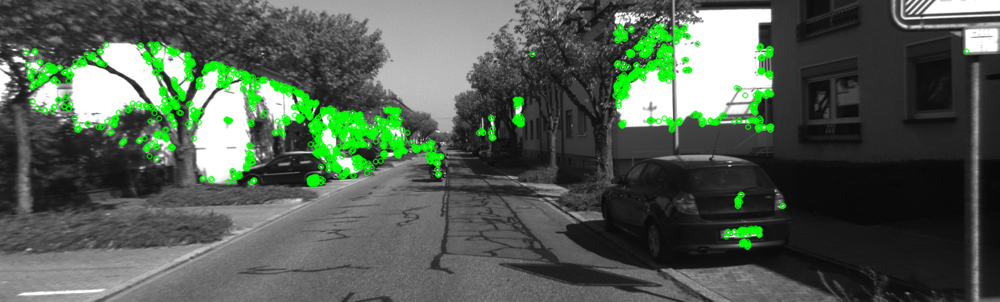
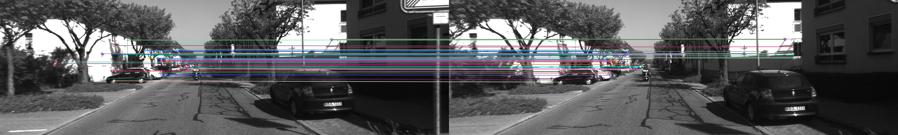

# Visual Odometry

## Feature Detection and Matching

### ORB Keypoint Detection

ORB (Oriented FAST and Rotated BRIEF) is used to detect distinctive image features and compute binary descriptors for matching across consecutive frames. The FAST algorithm detects keypoints by comparing pixel intensities in their surrounding neighbourhoods, while BRIEF generates binary descriptors through pairwise intensity comparisons around each keypoint. The following visualization shows the ORB keypoints detected in the first frame of a driving sequence.

### Feature Matching

ORB descriptors are matched between consecutive frames using a brute-force matcher. Each ORB descriptor is a 256-bit binary string representing the local visual appearance around a keypoint. The matcher compares every descriptor in one frame against those in the next, measuring their similarity using Hamming distance, which counts the number of differing bits between two binary descriptors:

$$
d_H(\mathbf{a},\mathbf{b}) = \sum_{i=1}^{256} \mathbb{1}(a_i \neq b_i)
$$

where $\mathbb{1}$ is the indicator function, equal to 1 when the corresponding bits differ and 0 otherwise. A smaller Hamming distance indicates greater descriptor similarity.

For each descriptor, the matcher identifies its nearest neighbour (the descriptor with the smallest Hamming distance). Cross-checking is then applied to retain only pairs where both descriptors are each other's nearest neighbours, reducing ambiguous matches.

The following visualization shows the 50 best descriptor matches between the first two frames of a driving sequence, with coloured lines connecting corresponding keypoints.

## Dataset

This project uses the [KITTI Visual Odometry Dataset](https://www.cvlibs.net/datasets/kitti/eval_odometry.php) to develop and evaluate camera-based vehicle localization algorithms.

The dataset is used for educational and research purposes and is not redistributed through this repository. Users must download the data separately from the official KITTI website and comply with its licensing and usage terms.

**Reference:**

Geiger, A., Lenz, P., & Urtasun, R. (2012). *Are we ready for autonomous driving? The KITTI Vision Benchmark Suite.* IEEE Conference on Computer Vision and Pattern Recognition (CVPR).

## Licence

The original source code in this repository is licensed under the MIT Licence. See the [LICENSE](LICENSE) file for details.

The KITTI dataset and any third-party materials are subject to their respective licences and are not covered by this project's MIT Licence.

